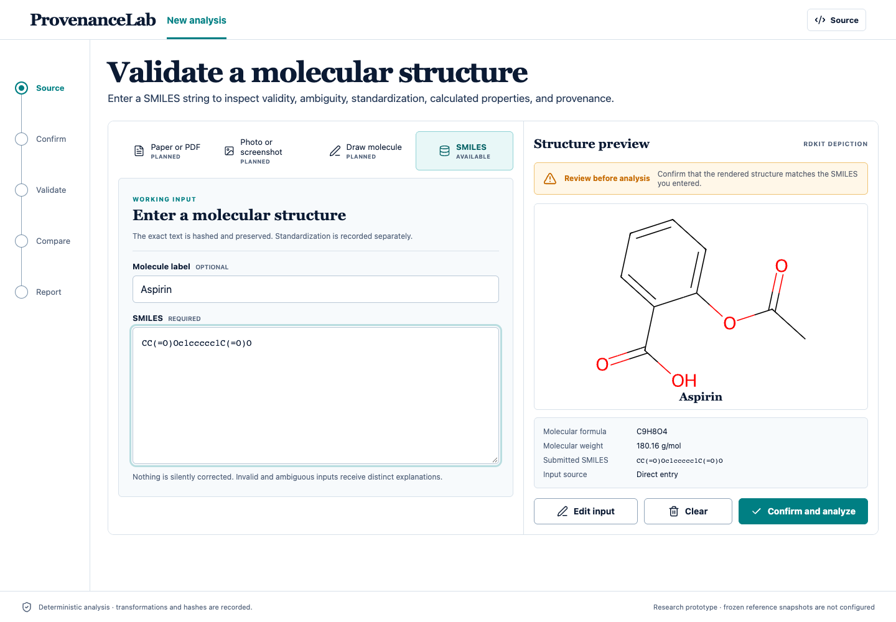
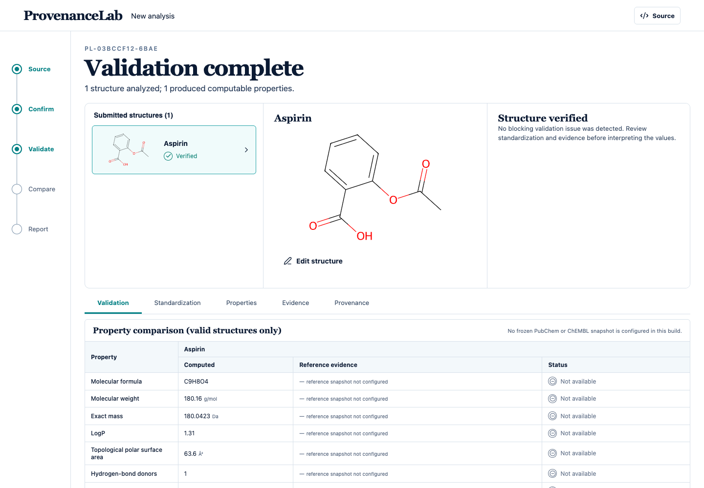
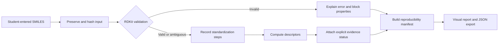

<div align="center">

# ProvenanceLab

### Molecular analysis that explains what it knows, what it cannot know, and why.

ProvenanceLab is a reproducibility-first web application for biotechnology students. It validates molecular inputs with RDKit, explains invalid and ambiguous structures in plain language, records every standardization step, computes molecular descriptors, and produces a verifiable run manifest without inventing missing evidence.

[](#project-status)
[](https://react.dev/)
[](https://fastapi.tiangolo.com/)
[](https://www.rdkit.org/)
[](https://www.python.org/)

</div>



The complete product scope, requirements, acceptance criteria, delivery plan, and risk register are available in the [Product Requirements Document](output/pdf/ProvenanceLab_Product_Requirements_Document_v1.0.pdf).

## Highlights

- **Precise validation:** distinguishes syntax errors, impossible valence, sanitization failures, and unresolved aromaticity.
- **Useful explanations:** every issue includes what happened, why it matters, where it occurred, and what the student should check next.
- **Ambiguity is not invalidity:** missing stereochemistry is reported as a warning instead of being silently guessed.
- **Traceable standardization:** cleanup, parent-fragment selection, charge normalization, and tautomer selection are recorded step by step.
- **Honest missing data:** unavailable, not applicable, outside coverage, and computation failure remain distinct machine-readable states.
- **Reproducible outputs:** each response records SHA-256 hashes, the ruleset, pipeline version, Python version, and RDKit version.
- **No trained model required:** the current chemistry pipeline is deterministic and rule based.

## Why ProvenanceLab?

Molecular structures copied from papers are often incomplete or inconsistent. A SMILES string may be syntactically broken, chemically impossible, missing stereochemistry, or represent a salt, charged form, or tautomer of the same parent compound. Property values can also change across toolkit versions, while spreadsheets frequently turn missing evidence into an unexplained blank or default value.

ProvenanceLab makes those uncertainties visible. It keeps the submitted input separate from standardized output, blocks calculations when a structure is invalid, and attaches explicit reason codes to every missing value.

## Project status

ProvenanceLab is a working **SMILES-analysis prototype**, not a finished production service. The frontend opens with three clearly labeled demonstration records. Their structures, descriptors, and small bootstrap reference set are illustrative; demo manifests deliberately contain no invented RDKit version or hashes. Student-entered SMILES are sent to the FastAPI/RDKit service only after confirmation.

The validation workspace opens on the invalid demo record to show the atom-level 3D error marker. Demo coordinates are illustrative, not optimized conformers. Live analyses use the RDKit 2D depiction because the service does not currently return a verified 3D conformer. The run-record dialog previews the exact JSON that its download action exports.

| Capability | Status | Current behavior |
| --- | :---: | --- |
| Direct SMILES input | ✅ Working | Accepts student-entered SMILES and preserves the submitted text |
| Photo or screenshot source | ✅ Working | Sends PNG, JPEG, or WebP depictions to local DECIMER, returns an editable SMILES candidate with token confidence, and requires source comparison before confirmation |
| Validation and explanatory errors | ✅ Working | Returns structured codes, explanations, locations, consequences, and next steps |
| Ambiguity detection | ✅ Working | Flags unassigned tetrahedral and E/Z stereochemistry without inventing a configuration |
| HM-01 edge-case corpus | ✅ Working | Runs 31 declared chemistry cases plus API-boundary and repeated-hash checks |
| Molecular visualization | ✅ Working | Generates an RDKit SVG depiction and highlights affected atoms when available |
| Parent standardization | ✅ Working | Records cleanup, fragment-parent, uncharging, and tautomer steps |
| Descriptor calculation | ✅ Working | Computes formula, mass, LogP, TPSA, H-bond counts, rotatable bonds, rings, and fraction Csp³ |
| Run manifest and JSON export | ✅ Working | Records deterministic hashes and tool versions; exports the analyzed response |
| Frozen PubChem/ChEMBL comparison | ⏳ Not configured | Returns `NOT_AVAILABLE` with `REFERENCE_SNAPSHOT_NOT_CONFIGURED`; no value is fabricated |
| Automatic paper/image recognition | 🗓️ Planned | Images are not automatically interpreted; extracted structures must remain untrusted until confirmed |
| Molecular drawing editor | 🗓️ Planned | Clearly marked unavailable; no placeholder canvas is presented |
| Persistent run archive and replay | 🗓️ Planned | The current confirmed input is held only in browser session storage |



## How it works



The browser never computes chemistry itself. React sends the confirmed input to the FastAPI service, where RDKit performs validation, standardization, depiction, and descriptor calculation. The API returns one structured record that drives every visible status in the interface.

## Quick start

### Requirements

- Python `3.11`, `3.12`, or `3.13`
- Node.js `20.19+` or `22.12+`
- npm

### 1. Clone and install

```bash
git clone https://github.com/Office50505/32-Bit.git
cd 32-Bit

python3.11 -m venv .venv
source .venv/bin/activate
pip install -e './backend[dev]'

cd frontend
npm ci
cd ..
```

### 2. Start the API

```bash
.venv/bin/uvicorn app.main:app --app-dir backend --reload --port 8000
```

### 3. Start the web application

In a second terminal:

```bash
cd frontend
npm run dev
```

Open [http://localhost:5173](http://localhost:5173). The Vite development server proxies `/api` requests to FastAPI on port `8000`.

## Use the application

1. Open **New analysis** and choose **SMILES** or **Photo or screenshot**.
2. Enter a molecular label if useful. For a photo, upload the source image and manually transcribe its SMILES; for direct input, enter the SMILES normally.
3. Review the generated structure and confirm that it matches the submitted notation.
4. Inspect validation, property, standardization, evidence, and provenance views.
5. Download the JSON run record for inspection or later comparison.

Try a few deliberately different states:

| Purpose | SMILES | Expected classification |
| --- | --- | --- |
| Valid structure | `CCO` | Valid |
| Missing stereochemistry | `CCC(O)C` | Ambiguous |
| Impossible valence | `C[O](C)C` | Invalid: `IMPOSSIBLE_VALENCE` |
| Broken notation | `C1CC` | Invalid: `SMILES_SYNTAX_ERROR` |

## Missing-value semantics

ProvenanceLab never collapses every blank result into “N/A.” The API preserves the reason:

| Status | Meaning |
| --- | --- |
| `AVAILABLE` | A value was computed or found in configured evidence |
| `INVALID_INPUT` | The molecular input is invalid, so calculation is blocked |
| `AMBIGUOUS_INPUT` | The input permits more than one chemically relevant interpretation |
| `NOT_COMPUTABLE` | The property does not have a computable value for this record |
| `NOT_AVAILABLE` | The source or configured system does not provide the value |
| `NOT_APPLICABLE` | The property or lookup does not apply to this record |
| `NO_REFERENCE_MATCH` | A snapshot is configured, but no matching compound was found |
| `OUTSIDE_SNAPSHOT_COVERAGE` | The query falls outside the declared snapshot scope |
| `COMPUTATION_ERROR` | A descriptor calculation failed unexpectedly |
| `CONFLICTING_EVIDENCE` | Computed and frozen reference values differ beyond tolerance |

## Reproducibility record

Every analyzed molecule includes:

- the original input and canonical/standardized representations;
- a SHA-256 hash of the input payload;
- a SHA-256 hash of the pipeline configuration;
- a SHA-256 hash of the analysis output;
- the pipeline and validation-ruleset versions;
- the exact Python and RDKit versions;
- the reference snapshot identifier and declared scope.

These fields make identical runs verifiable. Long-term replay of previous runs still requires persistent run storage and a configured, immutable evidence snapshot; both are explicitly tracked as unfinished work.

## API

FastAPI exposes interactive OpenAPI documentation at [http://localhost:8000/docs](http://localhost:8000/docs) while the backend is running.

| Method | Endpoint | Purpose |
| --- | --- | --- |
| `GET` | `/api/health` | Report service and chemistry-toolkit versions |
| `POST` | `/api/analyze` | Validate and analyze one molecular structure |
| `POST` | `/api/analyze/batch` | Analyze up to 100 structures in one request |

Example request:

```bash
curl -X POST http://localhost:8000/api/analyze \
  -H 'Content-Type: application/json' \
  -d '{"label":"Ethanol","structure":"CCO"}'
```

## Repository structure

```text
32-Bit/
├── backend/
│   ├── app/
│   │   ├── api/           # FastAPI routes
│   │   ├── core/          # hashes, versions, and manifest creation
│   │   ├── models/        # typed request and response contracts
│   │   └── services/      # validation, standardization, evidence, descriptors
│   └── tests/             # 31-case corpus, API boundaries, and reproducibility tests
├── frontend/
│   └── src/
│       ├── components/    # atomic React component hierarchy
│       ├── pages/         # analysis and results routes
│       ├── schemas/       # TypeScript API contracts
│       └── styles/        # responsive application design system
└── docs/                  # design system, concepts, and verified screenshots
```

## Quality checks

```bash
# Backend tests and linting
.venv/bin/pytest backend/tests
.venv/bin/ruff check backend

# Frontend linting and production build
cd frontend
npm run lint
npm run build
```

## Roadmap

- Expand the versioned edge-case corpus as new failure classes are discovered.
- Add versioned, checksum-verified PubChem and ChEMBL snapshot adapters.
- Add automatic paper/PDF segmentation and structure extraction; image recognition with mandatory student confirmation is already supported through DECIMER.
- Add a real molecular drawing editor as a lazy-loaded module.
- Support adding and comparing multiple student-provided molecules in one run.
- Persist immutable run records and provide exact replay by manifest.
- Add automated accessibility and end-to-end browser coverage.

## Feedback and contributing

Bug reports and focused feature proposals are welcome through [GitHub Issues](https://github.com/Office50505/32-Bit/issues). When reporting a chemistry result, include the submitted SMILES, the returned issue or reason code, and the run manifest when possible.

Please keep scientific behavior explicit: do not silently repair structures, substitute missing evidence, or relabel unavailable features as working.

## Acknowledgements

ProvenanceLab uses [RDKit](https://www.rdkit.org/) for molecular parsing, validation, standardization, depiction, and descriptor calculation. Planned reference-data integration targets frozen releases from [PubChem](https://pubchem.ncbi.nlm.nih.gov/) and [ChEMBL](https://www.ebi.ac.uk/chembl/).
