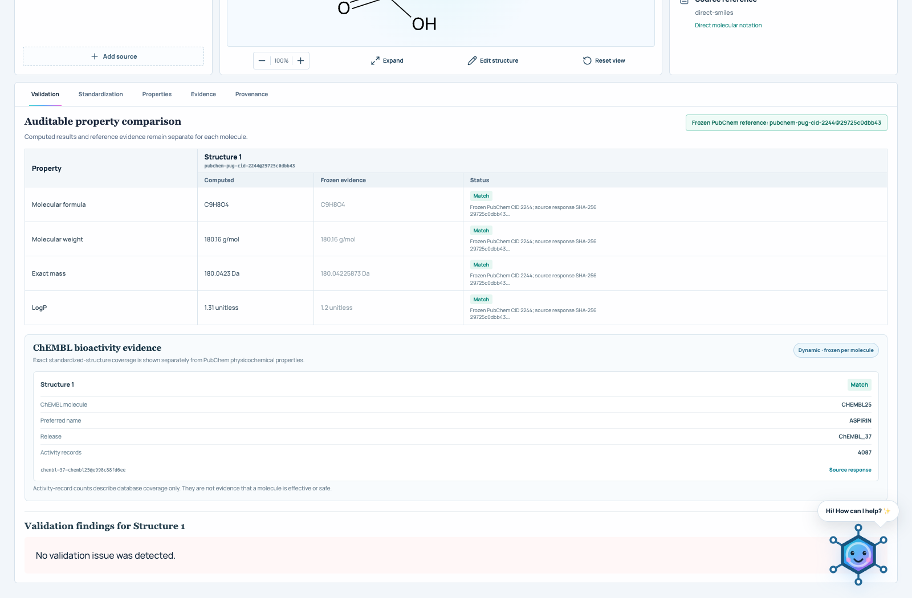
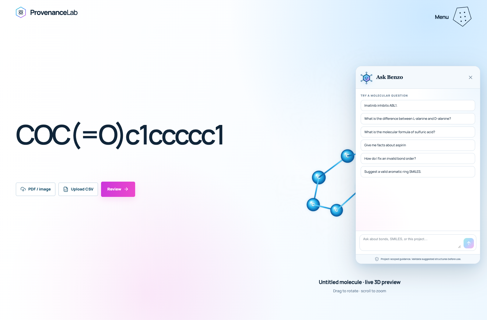
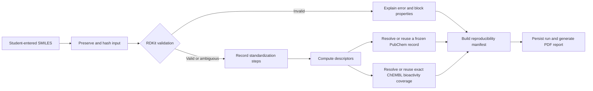

<div align="center">

# ProvenanceLab

### Molecular analysis that explains what it knows, what it cannot know, and why.

ProvenanceLab is a reproducibility-first molecular workspace for biotechnology students. It accepts direct SMILES, PDFs, molecular images, and CSV files; validates structures with RDKit; explains invalid and ambiguous inputs; records every transformation; compares computed descriptors with hash-verified PubChem records; and produces persistent, auditable run reports without inventing missing evidence.

[](#project-status)
[](https://react.dev/)
[](https://fastapi.tiangolo.com/)
[](https://www.rdkit.org/)
[](https://www.python.org/)

</div>


The complete product scope, requirements, acceptance criteria, delivery plan, and risk register are available in the [Product Requirements Document](output/pdf/ProvenanceLab_Product_Requirements_Document_v1.0.pdf).

## Highlights

- **Precise validation:** distinguishes syntax errors, impossible valence, sanitization failures, and unresolved aromaticity.
- **Useful explanations:** every issue includes what happened, why it matters, where it occurred, and what the student should check next.
- **Ambiguity is not invalidity:** missing stereochemistry is reported as a warning instead of being silently guessed.
- **Traceable standardization:** cleanup, parent-fragment selection, charge normalization, and tautomer selection are recorded step by step.
- **Explicit identity verdicts:** every pair in a run is labelled same exact molecule, same standardized parent, stereoisomers, different molecules, or indeterminate with a reason code.
- **Honest missing data:** unavailable, not applicable, outside coverage, and computation failure remain distinct machine-readable states.
- **Reproducible outputs:** each response records SHA-256 hashes, the ruleset, pipeline version, Python version, and RDKit version.
- **Deterministic chemistry:** validation and property computation are rule based; the optional image transcription path uses a pinned MolNexTR checkpoint and always requires human confirmation.
- **Source-aware ingestion:** PDFs, images, and CSV inputs show real hashing/extraction progress and preserve source metadata with the run.
- **Evidence on demand:** exact-identity PubChem records and eligible ChEMBL assay records are acquired once, checksummed, frozen locally, and reused.
- **Qwen evidence assistant:** Benzo calls the same claim-checking endpoint as the API and renders atomic statements, verdicts, citations, assay conflicts, calibrated confidence fields, safety notice, and immutable run citation.

## Why ProvenanceLab?

Molecular structures copied from papers are often incomplete or inconsistent. A SMILES string may be syntactically broken, chemically impossible, missing stereochemistry, or represent a salt, charged form, or tautomer of the same parent compound. Property values can also change across toolkit versions, while spreadsheets frequently turn missing evidence into an unexplained blank or default value.

ProvenanceLab makes those uncertainties visible. It keeps the submitted input separate from standardized output, blocks calculations when a structure is invalid, and attaches explicit reason codes to every missing value.

## Project status

ProvenanceLab is a working **research prototype**, not a prediction system for efficacy or safety. The current UI opens on a source-first molecular workspace with a live illustrative 3D preview. Every confirmed structure shown in the validation workspace comes from the FastAPI/RDKit backend—there are no demonstration records or fallback property values.

The evidence-backed 2D view is the authoritative molecular depiction. Normal atoms and bonds use a neutral palette; red is reserved for explicit validation findings. The optional 3D sketch is an interactive layout derived from the submitted SMILES, not an experimentally validated conformer.

| Capability | Status | Current behavior |
| --- | :---: | --- |
| Direct SMILES input | ✅ Working | Accepts student-entered SMILES and preserves the submitted text |
| PDF, image, and CSV sources | ✅ Working | Hashes every file in the browser, parses a declared CSV SMILES column, optionally transcribes PNG/JPEG/WebP structures with pinned MolNexTR, and requires confirmation before analysis; PDFs remain explicit manual transcriptions |
| Upload progress | ✅ Working | The active PDF/image or CSV button shows its real processing state and Review remains disabled until the source is ready |
| Validation and explanatory errors | ✅ Working | Returns structured codes, explanations, locations, consequences, and next steps |
| Ambiguity detection | ✅ Working | Flags unassigned tetrahedral and E/Z stereochemistry without inventing a configuration |
| HM-01 edge-case corpus | ✅ Working | Runs 31 declared chemistry cases plus API-boundary and repeated-hash checks |
| Molecular visualization | ✅ Working | Generates a neutral RDKit SVG and reserves red atom/bond highlights for actual validation findings; the 3D sketch remains illustrative |
| Parent standardization | ✅ Working | Records cleanup, fragment-parent, uncharging, and tautomer steps |
| Descriptor calculation | ✅ Working | Computes formula, mass, LogP, TPSA, H-bond counts, rotatable bonds, rings, and fraction Csp³ |
| PubChem property evidence | ✅ Working | Resolves the exact standardized InChIKey, freezes and verifies the PUG REST response, then keeps RDKit-computed and reference values in separate columns |
| ChEMBL bioactivity evidence | ✅ Working, scoped | Every valid standardized molecule receives an exact-InChIKey lookup with the matched ChEMBL ID, release, linked activity-record count, source response, and immutable snapshot ID; eligible molecule–target claims additionally receive claim-specific assay records |
| Evidence claim checking | ✅ Working, local setup required | Splits claims into statements and returns supported, contradicted, insufficient-evidence, or out-of-scope verdicts with record citations; activity is never supported from computed properties alone and retracted records are excluded |
| 150-claim evidence benchmark | ✅ Scientifically reviewed gold set | Contains 150 unique inputs, 165 expected atomic statements, 15 compound claims, exact evidence references, five leakage-grouped folds, all four verdict classes, and a signed dataset SHA-256 |
| Benzo evidence assistant | ✅ Working, Qwen model required | Calls `/api/evidence/check` and shows statement-level verdicts, citations, conflicts, confidence, the exact safety notice, and an immutable claim-check run citation |
| Immutable claim-check runs | ✅ Working | Persists every response by `assistant_run_id`, including abstentions and out-of-scope decisions, and rejects run-ID/content collisions |
| Persistent runs and PDF reports | ✅ Working | Stores deterministic run records in local SQLite, retrieves them by run ID, and generates a backend PDF report with hashes, identity verdicts, findings, properties, evidence states, and provenance |
| Exact replay verification | ✅ Working | Pins Python and every backend dependency, records the lock/environment fingerprint per run, recomputes the stored request, and distinguishes environment mismatch from output mismatch |
| Automatic paper recognition | 🗓️ Planned | PDF pages are preserved as sources but are not automatically segmented or interpreted; manual transcription remains explicit |
| Molecular drawing editor | 🗓️ Planned | Clearly marked unavailable; no placeholder canvas is presented |
| Run archive browser | 🗓️ Planned | Runs are persisted and individually replay-verifiable, but the UI does not yet list historical runs |






## How it works



The browser hashes attached source files but never computes chemistry itself. React sends the confirmed structure and source metadata to FastAPI, where RDKit performs validation, standardization, depiction, and descriptor calculation. Property evidence is resolved independently and never replaces the computed result. The API returns one structured record that drives every visible status in the interface.

## Quick start

### Requirements

- Python `3.11.17` for the locked replay environment
- Node.js `20.19+` or `22.12+`
- npm

### 1. Clone and install

```bash
git clone https://github.com/Office50505/32-Bit.git
cd 32-Bit

python3.11 -m venv .venv
source .venv/bin/activate
pip install -e './backend[dev]'

cd frontend
npm ci
cd ..
```

### Optional: local image-to-SMILES recognition

MolNexTR runs in a separate environment so its PyTorch stack cannot disturb the deterministic RDKit API. The model is loaded once and reused across image requests.

```bash
python3.11 -m venv .data/molnextr-venv
.data/molnextr-venv/bin/pip install -r backend/molnextr-requirements.txt
mkdir -p .data/molnextr
# Place the official checkpoint at .data/molnextr/molnextr_best.pth
shasum -a 256 .data/molnextr/molnextr_best.pth
```

The required checkpoint is [`molnextr_best.pth`](https://huggingface.co/datasets/CYF200127/MolNexTR/resolve/main/molnextr_best.pth?download=true), exactly 1,134,334,833 bytes with SHA-256 `5990bc19aaafa5cf44e9d04e06fb8e2b5aea50c66e1e925f662bdff7d2a6422c`. ProvenanceLab refuses to load a file that does not match both values.

### 2. Start the API

Benzo's project-scoped molecular assistant uses Qwen. Keep all model credentials on the
backend only—copy `.env.example` to `.env` and configure the private model settings before
starting the API:

```bash
cp .env.example .env
# Edit only local Qwen/Ollama endpoint overrides when needed.
set -a
source .env
set +a
```

```bash
.venv/bin/uvicorn app.main:app --app-dir backend --reload --port 8000
```

### 3. Start the web application

In a second terminal:

```bash
cd frontend
npm run dev
```

Open [http://localhost:5173](http://localhost:5173). The Vite development server proxies `/api` requests to FastAPI on port `8000`.

### 4. Run the native iOS application

On macOS with Xcode 16 or newer, open `ios/ProvenanceLabIOS.xcodeproj`, select an iPhone Simulator, and run the `ProvenanceLab` scheme. The app uses `http://127.0.0.1:8000` by default in Simulator and exposes a Server Settings screen for LAN or production HTTPS deployments. See [`ios/README.md`](ios/README.md) for signing and release notes.

## Use the application

1. Enter a SMILES directly, or attach a **PDF / image** or **CSV** source on the landing page.
2. Wait for the active upload button to finish hashing, parsing, or image extraction. Review stays disabled while the source is processing.
3. Select **Review**, compare the RDKit candidate with the source, and confirm it only when they match.
4. Inspect validation, standardization, properties, frozen evidence, and provenance. Add more sources to compare molecules in the same run.
5. Read the explicit molecule-identity verdicts in **Validate** or **Compare**.
6. Open **Report** to verify an exact replay or download the backend-generated PDF record.

Try a few deliberately different states:

| Purpose | SMILES | Expected classification |
| --- | --- | --- |
| Valid structure | `CCO` | Valid |
| Missing stereochemistry | `CCC(O)C` | Ambiguous |
| Impossible valence | `C[O](C)C` | Invalid: `IMPOSSIBLE_VALENCE` |
| Broken notation | `C1CC` | Invalid: `SMILES_SYNTAX_ERROR` |

## Missing-value semantics

ProvenanceLab never collapses every blank result into “N/A.” The API preserves the reason:

| Status | Meaning |
| --- | --- |
| `AVAILABLE` | A value was computed or found in configured evidence |
| `INVALID_INPUT` | The molecular input is invalid, so calculation is blocked |
| `AMBIGUOUS_INPUT` | The input permits more than one chemically relevant interpretation |
| `NOT_COMPUTABLE` | The property does not have a computable value for this record |
| `NOT_AVAILABLE` | The source or configured system does not provide the value |
| `NOT_APPLICABLE` | The property or lookup does not apply to this record |
| `NO_REFERENCE_MATCH` | A snapshot is configured, but no matching compound was found |
| `OUTSIDE_SNAPSHOT_COVERAGE` | The query falls outside the declared snapshot scope |
| `COMPUTATION_ERROR` | A descriptor calculation failed unexpectedly |
| `CONFLICTING_EVIDENCE` | Computed and frozen reference values differ beyond tolerance |

## Reproducibility record

Every analyzed molecule includes:

- the original input and canonical/standardized representations;
- a SHA-256 hash of the input payload;
- a SHA-256 hash of the pipeline configuration;
- a SHA-256 hash of the analysis output;
- the pipeline and validation-ruleset versions;
- the exact Python and RDKit versions;
- the reference snapshot identifier and declared scope.

These fields make identical runs verifiable. `backend/requirements.lock.txt`, `.python-version`, and `Dockerfile.replay` define the replay runtime. Run responses retain the original request and environment fingerprint in local SQLite; the replay endpoint recomputes the request and reports `MATCH`, `ENVIRONMENT_MISMATCH`, or `OUTPUT_MISMATCH`. Property and assay source payloads remain checksum-verified snapshots.

Verify a persisted run from the locked environment:

```bash
.venv/bin/python backend/scripts/replay_run.py PLR-YOUR-RUN-ID
```

The command exits `0` only for an exact environment-and-output match and exits nonzero for a
mismatch. Use `--database /path/to/provenancelab.sqlite3` when replaying a copied run database.

## API

FastAPI exposes interactive OpenAPI documentation at [http://localhost:8000/docs](http://localhost:8000/docs) while the backend is running.

| Method | Endpoint | Purpose |
| --- | --- | --- |
| `GET` | `/api/health` | Report service and chemistry-toolkit versions |
| `POST` | `/api/analyze` | Validate and analyze one molecular structure |
| `POST` | `/api/analyze/batch` | Analyze up to 100 structures in one request |
| `GET` | `/api/extract/image/engine` | Read local MolNexTR preparation status |
| `POST` | `/api/extract/image` | Transcribe a molecular image with the pinned local model |
| `POST` | `/api/runs` | Analyze and persist a deterministic multi-molecule run |
| `GET` | `/api/runs/{run_id}` | Retrieve a persisted run record |
| `POST` | `/api/runs/{run_id}/replay` | Recompute a stored request and verify environment/output hashes |
| `GET` | `/api/runs/{run_id}/report.pdf` | Generate the run’s auditable PDF report |
| `POST` | `/api/evidence/check` | Check a scientific claim against frozen PubChem/ChEMBL evidence |
| `GET` | `/api/evidence/runs/{assistant_run_id}` | Retrieve an immutable claim-check run, including abstentions and out-of-scope verdicts |

Example request:

```bash
curl -X POST http://localhost:8000/api/analyze \
  -H 'Content-Type: application/json' \
  -d '{"label":"Ethanol","structure":"CCO"}'
```

## Repository structure

```text
32-Bit/
├── backend/
│   ├── app/
│   │   ├── api/           # FastAPI routes
│   │   ├── core/          # hashes, versions, and manifest creation
│   │   ├── models/        # typed request and response contracts
│   │   └── services/      # validation, snapshots, assistants, reports, and persistence
│   ├── evaluation/        # frozen 150-claim evidence benchmark and validator
│   └── tests/             # chemistry corpus, API, evidence, snapshot, and reproducibility tests
├── frontend/
│   └── src/
│       ├── components/    # atomic React component hierarchy
│       ├── pages/         # analysis and results routes
│       ├── schemas/       # TypeScript API contracts
│       └── styles/        # responsive application design system
├── ios/
│   ├── ProvenanceLab/     # native SwiftUI application sources and assets
│   └── ProvenanceLabIOS.xcodeproj
└── docs/                  # design system, concepts, and verified screenshots
```

## Quality checks

```bash
# Backend tests and linting
.venv/bin/pytest backend/tests
.venv/bin/ruff check backend

# Frontend linting and production build
cd frontend
npm run lint
npm run build
```

## Roadmap

- Expand the versioned edge-case corpus as new failure classes are discovered.
- Expand exact-identity PubChem and claim-specific ChEMBL snapshot coverage and expose acquisition details in the UI.
- Add automatic paper/PDF segmentation and structure extraction; image recognition with mandatory student confirmation is already supported through MolNexTR.
- Add a real molecular drawing editor as a lazy-loaded module.
- Add searchable browsers for the existing molecule-run and claim-check-run records.
- Add automated accessibility and end-to-end browser coverage.

## Feedback and contributing

Bug reports and focused feature proposals are welcome through [GitHub Issues](https://github.com/Office50505/32-Bit/issues). When reporting a chemistry result, include the submitted SMILES, the returned issue or reason code, and the run manifest when possible.

Please keep scientific behavior explicit: do not silently repair structures, substitute missing evidence, or relabel unavailable features as working.

## Acknowledgements

ProvenanceLab uses [RDKit](https://www.rdkit.org/) for molecular parsing, validation, standardization, depiction, and descriptor calculation; [PubChem](https://pubchem.ncbi.nlm.nih.gov/) for exact-identity compound-property records; and [ChEMBL](https://www.ebi.ac.uk/chembl/) for structured assay evidence. All assistant output is a research aid, not a prediction of efficacy or safety.
